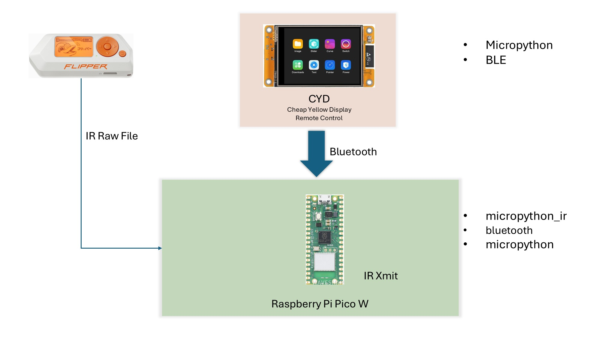

# PiRemote
This project covers the software used to create a Entertainment system remote control that manages IR connectivity. It uses a Raspberry Pi Pico that communicates with a remote client using Bluetooth connectivity.

The remote client is built on a CYD (Cheap Yellow Display) device and exposes the most useful functions (for me) for managing my entertainment system (TV, Reciever, Blueray, Cable box, Firestick, Chromecast).

